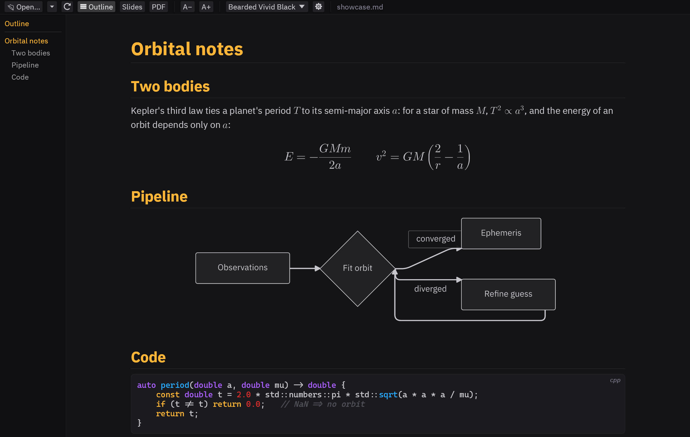
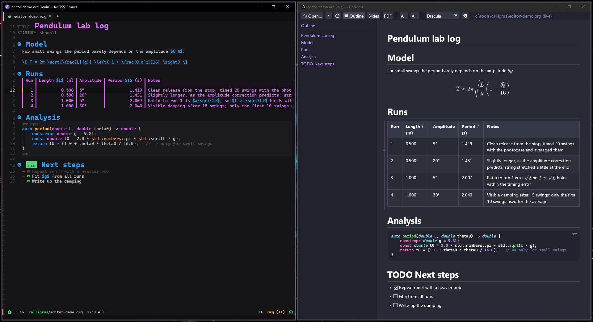

# Calligrus

A native Markdown and Org viewer with PDF export and editor integration that's not a browser!



## Motivation

I work a lot with Markdown documents. It's a good format for documentation and all the AI models love it. I also work a lot with Org documents within Emacs, which works great, but wide tables are a chore. So I wanted a good viewer for both Markdown and Org documents that had the following features:
- Proper tables and code blocks, and syntax highlighting.
- Proper LaTeX math rendering.
- Full Mermaid diagram support.
- Proper Neovim and Emacs integration.
- PDF export.
- Slideshow mode for lightweight presentations.

Not surprisingly, pretty much everything that had even some of the features I wanted was just a browser in a trenchcoat! Everything I could find was either an Electron app, or just a front-end to invoke the system webview. I wanted something that's native and doesn't eat hundreds of megabytes of RAM just to start up! So I thought I'd see just how far I could get with the current generation of models. Turns out, the answer was surprisingly far! 

Everything here was made using the Claude family of models: `claude-opus-5-5` for the overall planning and direction, `claude-sonnet-5-5` and sometimes `claude-haiku-5-5` for implementations. My role was to guide the development, plan out the features, and hunt for bugs.

## Features

- **Markdown and Org**: GitHub-flavoured Markdown (tables, task lists, footnotes, callouts) and Org files (headlines, lists, tables, `#+begin_src` blocks, LaTeX fragments), parsed into the same document model.
- **TeX maths**: inline and display, typeset by its own layout engine with Latin Modern Math (`aligned`, matrices, `cases`, stretchy delimiters, `\tag`, …).
- **Mermaid**: all 23 diagram types rendered natively, no browser and no Node.
- **Syntax highlighting**: tree-sitter grammars for 21 languages, compiled in.
- **Vim-style keys**: `j`/`k`, counts, `gg`/`G`, `]]`/`[[` between headings, marks (`m` / `'`), `*` / `#`, `H` / `L` for back and forward. They can be turned off.
- **Tabs**, an **outline** panel, **find**, and a **recent files** popup.
- **15 themes**, including Dracula, Nord, Gruvbox, Solarized, Catppuccin, Tokyo Night, GitHub and Bearded Vivid Black. Press `t` to preview them live. You can also add your own.
- **Slides**: present any document with `F5`, with a presenter window, speaker notes and a clock.
- **PDF export**: pages (A4 or Letter) with real, selectable and searchable text, or slide decks.
- **Editor integration**: Emacs and Neovim show the buffer you're editing as you type, scroll along with your cursor, and Ctrl+click in the preview jumps back to that line.
- **Complex scripts**: Devanagari, Gujarati and other scripts are shaped properly, using system fonts for characters the bundled fonts don't have.
- **One file**: a single executable with fonts, themes and grammars built in. No runtime to install.

## Install

Download the archive for your system from the [Releases](../../releases) page, unzip it, and run `calligrus` (`calligrus.exe` on Windows). There's nothing to install.

On Windows, `calligrus --register` adds it to "Open with" for `.md` and `.org` files (per user, no admin), and `calligrus --unregister` removes that again.

To build it yourself, see [BUILDING.md](BUILDING.md).

## Usage

```sh
calligrus notes.md            # open a file (several files open in tabs)
calligrus --slides talk.md    # start in slides mode
calligrus --help              # every command-line option
```

The first screen is a short tour of the keys. The most useful ones:

| Keys | What happens |
|:-----|:-------------|
| `j` / `k`, `d` / `u`, `gg` / `G` | scroll, half pages, top and bottom (with counts: `5j`) |
| `]]` / `[[` | next / previous heading |
| `o` or `Ctrl+B` | outline |
| `/` or `Ctrl+F`, then `n` / `N` | find |
| `t` | theme picker |
| `H` / `L`, `Alt+←` / `Alt+→` | back / forward |
| `m` + letter, `'` + letter | set a mark, jump to it |
| `Ctrl+O`, `Ctrl+Shift+O` | open a file, recent files |
| `Ctrl+T`, `Ctrl+Tab`, `Ctrl+W` | new tab, next tab, close tab |
| `F5` | slides on / off |

A common shell alias is `calli`:

```sh
alias calli=calligrus                             # bash / zsh
```
```powershell
Set-Alias calli calligrus                         # PowerShell, in $PROFILE
```

### PDF export from the command line

```sh
calligrus --export notes.pdf notes.md --pages                 # pages, A4, the light theme
calligrus --export notes.pdf notes.md --pages --paper letter --theme dracula --body-size 11
calligrus --export talk.pdf talk.md                          # the slides as a deck
```

`--body-size` is the text size in points (8 to 64); without it, the config's text size is used. `--base-dir DIR` resolves relative pictures and links from another folder, which is useful when the input comes from somewhere else.

## Configuration

Settings are changed in the app (the gear in the toolbar) and saved to `config.toml` in a `calligrus` folder:

- `$XDG_CONFIG_HOME/calligrus` if `XDG_CONFIG_HOME` is set,
- otherwise `~/.config/calligrus` if a `~/.config` folder exists (always on Linux),
- otherwise `%APPDATA%\calligrus` on Windows.

A folder that already exists in one of those places is always used. Your own themes go in `themes/` inside it. `CALLIGRUS_CONFIG` can point to a different config file.

## Editor integration



### Emacs

```elisp
(add-to-list 'load-path "/path/to/calligrus/editors/emacs")
(require 'calligrus)
(setq calligrus-exe "/path/to/calligrus")
```

`M-x calligrus-toggle` in a Markdown or Org buffer opens the preview, and `M-x calligrus-stop` closes it. See [editors/emacs/README.md](editors/emacs/README.md) for the options.

### Neovim

```lua
vim.opt.rtp:append("/path/to/calligrus/editors/nvim")
require("calligrus").setup({ exe = "/path/to/calligrus" })
```

`:CalligrusToggle` opens the preview for the current buffer. See [editors/nvim/README.md](editors/nvim/README.md) for the options.

## Documentation

[spec/SPEC.md](spec/SPEC.md) is the detailed specification: every key, setting and behaviour, plus the test setup.

## Licence

Copyright (C) 2026 KαΩSS (theKAOSSphere).

Calligrus is free software: you can redistribute it and/or modify it under the terms of the GNU General Public License as published by the Free Software Foundation, either version 3 of the License, or (at your option) any later version. See [LICENSE](LICENSE). The bundled fonts, libraries, grammars and the sources of the themes are listed with their licences in [THIRD-PARTY.md](THIRD-PARTY.md).
