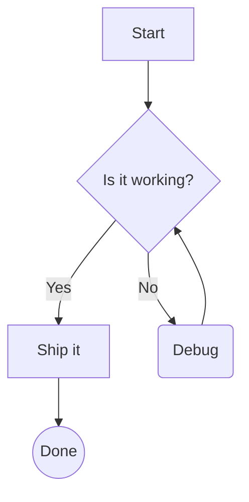
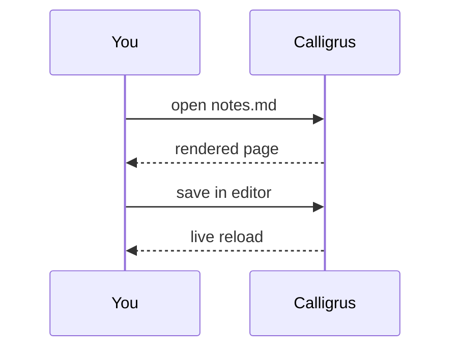

# Calligrus — a native Markdown and Org viewer

A native Markdown and Org viewer without utilising any web technologies. GPU-accelerated rendering powered by **Dear ImGui**. Fully supports TeX-style math equations with a custom layout engine, and typeset using the *Latin Modern Math* font.

Open a file using **Ctrl+O**, drag and drop one onto the window, or pass a path on the command line. File changes on disk are reflected automatically.

## Things to try

| Keys | What happens |
|:-----|:-------------|
| **j** / **k**, **d** / **u**, **gg** / **G** | scroll, half pages, top and bottom (counts work: **5j**) |
| **]]** / **[[** | next / previous heading |
| **o** or **Ctrl+B** | the outline of headings |
| **/** or **Ctrl+F**, then **n** / **N** | find, and step through the matches |
| **t** | the theme picker: **j** / **k** preview each theme live, **Enter** keeps one, **Esc** goes back |
| **Ctrl+=** / **Ctrl+-** / **Ctrl+0** | bigger, smaller, normal text |
| **Ctrl+T**, **Ctrl+Tab**, **Ctrl+W** | open a file in a new tab, switch tabs, close one |
| **Ctrl+Shift+O** | recent files |
| **F5** | present this document as slides (**F5** or **Esc** to leave) |

Vim-style navigation keys are on by default, but they can be turned off in the settings (gear icon in the toolbar).

- **PDF export**: the **PDF** button turns the document into pages (A4 or Letter, with real, selectable text) or the slides into a deck.
- **Your editor**: the Emacs and Neovim plugins show a live preview of the current buffer. Changes are reflected as you type, the preview scrolls along with your cursor, and Ctrl+click jumps the editor to that line.
- **Org files**: headings, lists, tables, `#+begin_src` blocks and LaTeX fragments all render the same way as Markdown.
- **Any script**: text in scripts such as Devanagari or Gujarati is shaped properly when a system font has it.

## Text

Regular, **bold**, *italic*, ***bold italic***, ~~strikethrough~~, `inline code`, and a [link](https://isocpp.org). Inline math flows with the text on a shared baseline, like $e^{i\pi} + 1 = 0$ or $\sum_{k=1}^{n} k^2 = \frac{n(n+1)(2n+1)}{6}$, and wraps with the paragraph around it: the quick brown fox jumps over the lazy dog, then again, then again, until the line is long enough to wrap onto a second line that also contains $\alpha, \beta, \gamma$.

> Block quotes are indented with a bar, and can hold anything:
>
> $$\hat{f}(\xi) = \int_{-\infty}^{\infty} f(x)\, e^{-2\pi i x \xi}\, dx$$

## Display math

The Gaussian integral and a few friends:

$$\int_{-\infty}^{\infty} e^{-x^2}\,dx = \sqrt{\pi}$$

$$\sum_{n=1}^{\infty} \frac{1}{n^2} = \frac{\pi^2}{6} \qquad \prod_{p\ \text{prime}} \frac{1}{1-p^{-s}} = \sum_{n=1}^{\infty} \frac{1}{n^s}$$

Maxwell's equations:

$$\begin{aligned}
\nabla \cdot \mathbf{E} &= \frac{\rho}{\varepsilon_0} \\
\nabla \cdot \mathbf{B} &= 0 \\
\nabla \times \mathbf{E} &= -\frac{\partial \mathbf{B}}{\partial t} \\
\nabla \times \mathbf{B} &= \mu_0 \mathbf{J} + \mu_0 \varepsilon_0 \frac{\partial \mathbf{E}}{\partial t}
\end{aligned}$$

Matrices, cases, and stretchy delimiters:

$$A = \begin{pmatrix} a_{11} & a_{12} & \cdots & a_{1n} \\ a_{21} & a_{22} & \cdots & a_{2n} \\ \vdots & \vdots & \ddots & \vdots \\ a_{m1} & a_{m2} & \cdots & a_{mn} \end{pmatrix}, \qquad |x| = \begin{cases} x & \text{if } x \ge 0 \\ -x & \text{if } x < 0 \end{cases}$$

$$\left( \frac{\partial^2}{\partial x^2} + \frac{\partial^2}{\partial y^2} \right) u(x, y) = \lambda\, u(x, y) \tag{1}$$

$$\lim_{n \to \infty} \left(1 + \frac{1}{n}\right)^{n} = e \qquad \sqrt[3]{\frac{x^3 + y^3}{2}} \qquad \overbrace{a + b + \cdots + z}^{26}$$

## Lists

- Unordered lists
  - nest to any depth
    - with their own markers
- Items can hold **formatting**, `code` and math like $\mathbb{R}^n$
- [x] task lists
- [ ] with check boxes

1. Ordered lists
2. keep their numbering
   1. and nest too
3. like this

## Tables

| Function | Formula | Notes |
|:---------|:-------:|------:|
| Sine | $\sin x = \sum_{k=0}^\infty \frac{(-1)^k x^{2k+1}}{(2k+1)!}$ | converges everywhere |
| Gamma | $\Gamma(z) = \int_0^\infty t^{z-1} e^{-t}\,dt$ | extends the *factorial* |
| Normal | $\frac{1}{\sigma\sqrt{2\pi}} e^{-\frac{(x-\mu)^2}{2\sigma^2}}$ | **bell** curve |
| Plain text | just words | columns can be left, centred or right aligned |

## Marks

With vim keys on, in normal reading mode:

- **m** + a letter marks the spot at the top of the view; **'** + the letter jumps back, and **''** returns to where you were. Capitals (**mA**…) work across files.
- **\*** / **#** search for the selected text, or the word under the mouse.

## Code

```rust
fn main() {
    let name = "calligrus";
    println!("Hello from {name}!");
}

fn has_text(text: &str) -> bool {
    text.trim().len() != 0
}
```

## Diagrams

Fenced code blocks tagged `mermaid` are drawn as diagrams (natively, no browser):





---

That's the tour! Press **Ctrl+O** to open one of your own files, or **t** to find a theme you like. Enjoy the views!
