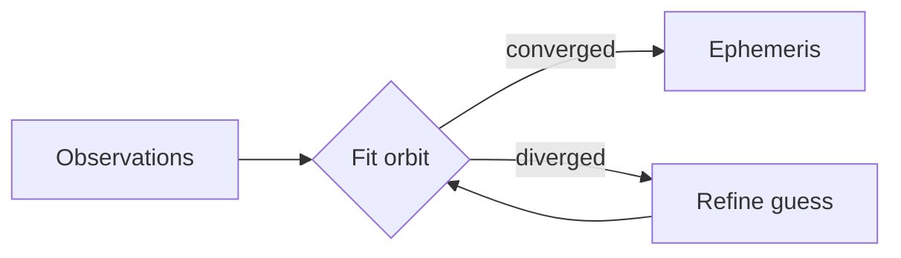

# Orbital notes

## Two bodies

Kepler's third law ties a planet's period $T$ to its semi-major axis $a$: for a star of mass $M$, $T^2 \propto a^3$, and the energy of an orbit depends only on $a$:

$$E = -\frac{G M m}{2a} \qquad v^2 = G M \left( \frac{2}{r} - \frac{1}{a} \right)$$

## Pipeline



## Code

```cpp
auto period(double a, double mu) -> double {
    const double t = 2.0 * std::numbers::pi * std::sqrt(a * a * a / mu);
    if (t != t) return 0.0;   // NaN => no orbit
    return t;
}
```
