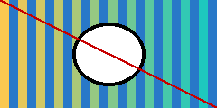

# Talk title

A slide with notes and two steps.

<!-- pause -->

The second step.

<!-- speaker_note: Say hello. Then press the right arrow for the second step. -->

---

## Middle

- one
- two

<!-- speaker_note: |
  The picture is a Marp background.
  Two lines of notes.
-->

---

## The end

Thanks!
